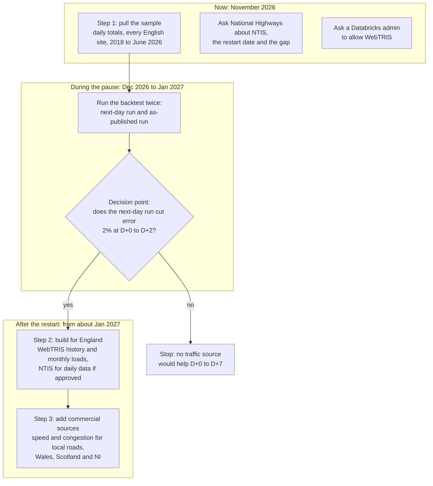

# Traffic Busyness Research Report

23 Nov 2026 · Joe Myers · Status: draft

A plain-English summary of the research behind the [brief](traffic_busyness_brief.md),
with every acronym defined. Full findings and sources:
[`docs/research/traffic-busyness-feature.md`](research/traffic-busyness-feature.md).

---

## Summary

National Highways' WebTRIS counts can show whether roads are busier than normal, but they arrive monthly and stopped at 30 June 2026. So they cannot yet feed forecasts made a few days ahead. The plan is to test the value on history first, then build for England, then consider paid sources for the rest of the UK.

- **The data:** WebTRIS gives 15-minute vehicle counts from about 11,000 fixed counters on England's motorways and major A-roads. It is free, but published a month late, and paused since June 2026.
- **Live data:** the only source of the same counters day by day is NTIS, National Highways' live system. It needs an approved subscription and covers England's motorways and major A-roads only.
- **The rest of the UK:** no open daily counts exist for Wales, Scotland or Northern Ireland. TomTom, INRIX and HERE cover every road live, but they sell speed and congestion, not counts.
- **The test:** pull daily totals for every English counter from January 2018 to June 2026, then replay past forecasts with and without the feature.
- **The decision:** if traffic known by the next morning would not have lowered forecast error, stop. If it would, pursue NTIS and build for England once WebTRIS restarts.

## Glossary

Every acronym and term in this report, in alphabetical order.

| Term | What it means |
| --- | --- |
| AA | The Automobile Association, whose breakdown demand we forecast |
| ANPR | Automatic Number Plate Recognition: cameras that read number plates to time journeys |
| API | Application Programming Interface: a web address a program calls to fetch data |
| ATC | Automatic Traffic Counter: DfT's name for a permanent counting site |
| Backtest | Replaying past forecasts as if they were made at the time, to measure how accurate they would have been |
| BST, GMT | British Summer Time and Greenwich Mean Time: the UK clock in summer (one hour ahead of UTC) and in winter (equal to UTC) |
| Clark-West test | A statistical test of whether adding inputs to a forecast model really lowers its error |
| COVID window | 1 March 2020 to 31 July 2021, left out when working out normals |
| Coverage (`TR_COVERAGE`) | The share of a region's expected traffic that actually reported |
| D+0 to D+7 | Forecasts for the same day (D+0) up to seven days ahead (D+7) |
| Databricks | The data platform where our forecasting tables live |
| DATEX II | The European standard format for traffic data feeds |
| `dbreferences` | Our Databricks area holding the shared mapping tables (squares to regions, hours to periods) |
| DfI | Department for Infrastructure, Northern Ireland's roads department |
| DfT | Department for Transport |
| Diebold-Mariano test | A common test for comparing two forecasts' accuracy; it misleads when one model is the other plus extra inputs |
| Floating car data | Positions and speeds reported by moving vehicles and phones, as sold by INRIX |
| GB, UK | Great Britain (England, Scotland, Wales); United Kingdom (Great Britain plus Northern Ireland) |
| HALOGEN | An older National Highways system that lets registered users download MIDAS counts |
| HERE, INRIX, TomTom | Commercial companies that sell traffic data |
| LASSO | Least Absolute Shrinkage and Selection Operator: our regression method, which drops inputs that do not help |
| `MAP_1K` | One Ordnance Survey 1 km grid square, our smallest unit of space |
| MIDAS | Motorway Incident Detection and Automatic Signalling: counters on motorways, about every 500 m |
| NCA | One of the 13 regional areas in our demand tables (NCA01 to NCA13); NCA06 is Wales |
| NI | Northern Ireland |
| Normal | What a counter usually counts at that hour on a comparable day |
| NTIS | National Traffic Information Service: National Highways' live traffic system |
| OGL | Open Government Licence: lets anyone reuse public data, commercially too, with a credit |
| ONS | Office for National Statistics |
| OS | Ordnance Survey, Britain's mapping agency; its grid gives eastings and northings |
| PGA | Another regional grouping in our mapping tables |
| PR | Pull request: a proposed change to the code repository, reviewed before it is merged |
| Quality % | WebTRIS's completeness measure: minutes of data received divided by minutes in the period |
| R | The statistics programming language the old traffic tool was written in |
| R2 | Cloudflare's file storage, used by the repository for files kept outside git |
| Serverless network policy | A Databricks setting listing the outside websites its serverless compute may reach |
| Site | One counter on one carriageway in one direction; northbound and southbound are separate sites |
| SRN | Strategic Road Network: England's motorways and major A-roads, run by National Highways |
| TAME | Traffic Appraisal, Modelling and Economics: counters mostly on A-roads |
| TB-101 and similar | Task numbers in the brief |
| TMU | Traffic Monitoring Unit: counters mostly on A-roads |
| `TR_AVAILABLE_FROM` | The date a value would first have been published, so a forecast only uses what existed |
| `TR_RATIO` | The busyness ratio: counts divided by the same counters' normals; 1.10 means 10% busier |
| UTC | Coordinated Universal Time: the clock with no summer change |
| VEH0105 | DfT's quarterly table of licensed vehicles by local authority |
| Volume | A folder of files inside Databricks, where an outside file can be uploaded |
| WebTRIS | National Highways' public website and API for historic traffic counts |

## The goal

The feature answers one question for our demand models: are the roads in this area busier or quieter than normal, at this time? It replaces an old R tool that made one national monthly number and was never joined to a forecast.

- **How it works:** for each region and period, add up the counts from counters that reported. Divide by what those same counters normally count then. The result, `TR_RATIO`, reads 1.10 when roads are 10% busier than normal.
- **Any grain:** counters map to 1 km squares, squares map to regions (NCA, PGA, cluster), and hours map to periods (hour, 4-hour block, day). The existing mapping tables do this, so the same code works at any grain.
- **Why each counter against its own normal:** counters fail and come back, and a motorway loop counts the same car many times along a road. Comparing each counter only with itself keeps both effects out of the ratio.

## WebTRIS: the data and why it stopped

WebTRIS is free, open and detailed, but it is published monthly, a month late, and nothing has been published after 30 June 2026.

**What it holds**

- 15-minute counts per counter: total vehicles, average speed, and counts by vehicle length.
- About 11,000 active counters on England's SRN.
- A rolling 10 years of history. On 20 November 2026 the earliest date it accepted was 20 November 2016.

**Quirks found by testing the API on 20 November 2026**

- Times are UK local clock time, not UTC. A clocks-forward day has 23 hours of data, and a clocks-back day loses one hour of counts.
- A missing slot comes back empty, so a real zero and a gap can be told apart.
- Rows carry the counter's name, not its number, and five pairs of counters share a name.
- The site list has not changed since early 2023, and its Active flag does not show which counters still report.
- The licence is the OGL. There is no key and no published usage limit, and all four web addresses work.

**Why it stopped**

National Highways paused new uploads while it changes the systems behind WebTRIS, which it calls "new data pipelines". It expects the pause to last three to four months from 17 September 2026, and has given no further detail. DfT's travel-time statistics for the same roads also stop at June 2026, "as National Highways undertake essential developments".

| Notice | What National Highways said |
| --- | --- |
| 17 Sep 2026 | Monthly uploads paused; history still available; pause of three to four months |
| 31 Jan 2026 | Interruption now expected mid-2026, lasting three to six months |
| 30 Apr 2025 | Interruption delayed to mid-2025 |
| 11 Jul 2024 | Interruption delayed to early 2025 |
| 8 Mar 2024 | Interruption from April 2024; data collected meanwhile to be uploaded afterwards |

Only the March 2024 notice promised to fill the gap afterwards. Sources: [WebTRIS news](https://webtris.nationalhighways.co.uk/Home/News), [WebTRIS FAQ](https://webtris.nationalhighways.co.uk/Home/Faqs), [DfT travel time measures](https://www.gov.uk/government/statistics/travel-time-measures-for-the-strategic-road-network-england-and-local-a-roads-great-britain-july-2025-to-june-2026).

## Which counters actually report

In 2025, 63% of active MIDAS and 55% of active TMU counters were usable, but only 4% of TAME counters. A counter is usable in a year when at least 80% of its days have quality of 90% or more.

| Year | MIDAS usable | TMU usable | TAME usable |
| --- | --- | --- | --- |
| 2018 | 50% | 52% | 27% |
| 2019 | 52% | 62% | 18% |
| 2020 | 52% | 58% | 28% |
| 2021 | 59% | 50% | 15% |
| 2022 | 60% | 39% | 9% |
| 2023 | 54% | 34% | 7% |
| 2024 | 58% | 36% | 1% |
| 2025 | 63% | 55% | 4% |
| 2026 (Jan to Jun) | 71% | 65% | 1% |

WebTRIS daily quality for 400 sampled sites (100 active of each type, 100 inactive), 1 Jan 2018 to 30 Jun 2026, pulled 20 Nov 2026. The scripts are in [`docs/research/archive/2026-11-21-traffic-busyness-feature/`](research/archive/2026-11-21-traffic-busyness-feature/).

So coverage has to come from the data, not the Active flag: 38 of the 300 sampled active counters sent nothing at all from 2018 onwards. Daily quality is nearly all or nothing: 59.5% of counter-days scored zero and 39% scored 90% or more.

## Other sources and UK coverage

Only one source gives hourly counts at fixed points every day: NTIS, and it covers England's SRN only. Nothing open does this for Wales, Scotland or Northern Ireland.

| Source | What it gives | Where | How fresh | Access |
| --- | --- | --- | --- | --- |
| NTIS (National Highways) | Flow, speed and occupancy per counter | England's SRN: the same counters as WebTRIS | Live | Approved subscribers only; it sends data to a server we would host |
| WebTRIS (National Highways) | 15-minute counts per counter | England's SRN | Monthly, a month late; paused | Open, no key |
| DfT daily traffic index | One index for all of Great Britain, from about 275 counters | Great Britain | 3 days to 5 weeks old | Open |
| TomTom, INRIX, HERE | Speed, travel time and congestion per road stretch | Every UK road | Live | Paid |
| Traffic Scotland, Traffic Wales, TrafficWatchNI | Incidents, journey times, road status | Each nation's main roads | Live | Registration; no counts |
| Greater Manchester, Newcastle | Counts at traffic signals or from cameras | Those cities | Live | Open; terms not checked |

- **Scotland:** Transport Scotland runs over 1,500 counters but does not publish their data. Ask at transtat@transport.gov.scot.
- **Wales:** the 26 WebTRIS counters in Wales are all on the border.
- **Northern Ireland:** the DfI had 60 counters in 2024 and publishes annual summaries only.
- **England's local roads:** councils run them, and there is no national feed.

NTIS evidence comes from sample code its contractor published, listing feeds of "raw (unprocessed) real-time traffic data measured by" MIDAS and TMU loops ([NTIS subscriber service](https://raw.githubusercontent.com/ntisservices/ntis-java-web-services-Release3.14/master/NTISSubscriberService-Information.txt)). Its own documentation site could not be read from here.

## Commercial providers: terms

Their exact terms for our use are not public. Each sells a pay-per-request live feed that limits storing data, and a historical licence priced by contract. A feature that keeps years of history and trains models needs the historical licence.

| | TomTom | HERE | INRIX |
| --- | --- | --- | --- |
| Live feed price | About 2,500 free requests a day, then about $0.75 per 1,000 (third-party figures) | Pay per request; an older figure was 5,000 free, then $2.50 per 1,000 | Not published |
| Keeping data | Brief caching only, per a summary of its address-lookup terms | Not found for traffic | Set by contract; standard terms let historical customers keep data received during the contract |
| History product | Traffic Stats, priced by length of road; 30-day trial | Traffic Analytics; terms not found | Roadway Analytics, back to 1 January 2014 |

Questions to ask each provider:

- Can we store hourly data indefinitely and use it for normals and model training?
- What does all-UK coverage cost, including Northern Ireland, hourly and delivered daily?
- Do you offer vehicle volumes, or only speeds?
- Does history go back to 2018?

These figures come from search results, not the full terms documents. INRIX is reportedly being bought by Arity, which Allstate owns. Sources: [TomTom traffic APIs](https://www.tomtom.com/products/traffic-apis/), [TomTom Traffic Stats](https://www.tomtom.com/products/traffic-stats/), [HERE traffic docs](https://docs.here.com/here-sdk/docs/flutter-traffic), [INRIX standard licence terms](https://d7umqicpi7263.cloudfront.net/eula/nM9efHauPLZEt8Wm5b2RkPXRz_7Jup5B1oTT3jiG6W8), [INRIX Roadway Analytics data](https://docs.inrix.com/ra/datanetworkandxdtraffic/).

## Building the feature well

Official statistics already do something close to this, so the design follows DfT and ONS practice.

- **Normals:** the median count for the same weekday and hour, within 14 days of the date, in each of the three previous years. Bank holidays compare with the same holiday in earlier years, and 24 December to 1 January with the same dates. The COVID window is left out. No source we found uses week-of-year normals, which the brief first proposed.
- **Why rebuild each year:** ONS advised DfT to update its reference year every year, because a fixed base drifts as traffic grows. Using only earlier years also keeps future data out of the test.
- **Combining counters:** add up the counts, add up the same counters' normals, and divide. DfT does the same with a matched set of counters. ONS's 2019 WebTRIS indicator averaged whichever sensors worked, and showed false swings when sensors dropped out.
- **Coverage:** measure it against counters that have a normal, not the Active flag. Leave the ratio empty when coverage is below 50%, or when fewer than 30 counters are expected. That second rule is what empties Wales.
- **Faults:** set aside a counter's day if it repeats the same count of 10 or more for 8 slots in a row, reads zero all day, or lands below 5% or above 300% of normal. These are starting values; no UK source publishes thresholds.
- **Never fill gaps,** and leave clock-change hours out of both sums.

Sources: [DfT methodology review](https://assets.publishing.service.gov.uk/media/6333371cd3bf7f567eeb5cbe/traffic-statistics-methodology-review.pdf), [DfT quarterly methods review](https://assets.publishing.service.gov.uk/media/6333374dd3bf7f56768dc38e/traffic-statistics-methodology-review-quarterly-methods.pdf), [ONS Data Science Campus road traffic project](https://datasciencecampus.ons.gov.uk/projects/faster-indicators-of-uk-economic-activity-road-traffic-data-for-england/).

## Testing whether it helps

The test must use only data that would have existed when each forecast was made. Otherwise it overstates the feature's value.

- **Publication dates:** every value carries `TR_AVAILABLE_FROM`, the date it would first have been published. A forecast made on a given day uses only values published by then.
- **Two runs:** a next-day run, as if each day's data arrived the following morning, which is what NTIS would give. And an as-published run, with WebTRIS's real delay of one to two months.
- **Normals from the past only:** each year's normals use earlier years, so the test never sees the future.
- **The right statistical test:** comparing a model with the same model plus extra inputs needs a Clark-West test. The common Diebold-Mariano test misleads in that case.
- **Pass marks set before the run:** proposed 1% lower error to keep the feature, and 2% lower at D+0 to D+2 to justify a daily feed.
- **No prior evidence either way:** we found no published study of traffic predicting breakdown demand. A study of Swiss ambulance calls found traffic added nothing beyond the hour of day.

Sources: [Forecasting: Principles and Practice](https://otexts.com/fpp3/regression.html#sec-forecasting-regression), [nested-model forecast tests](https://arxiv.org/abs/2008.08387), [Swiss ambulance study](https://arxiv.org/abs/2501.03111).

## The plan

Test on history now, decide in the new year, and build only if the test passes.

The test needs nothing new from National Highways, so it can run during the pause. The build waits for the restart, because the rebuilt WebTRIS may change its address or format. If the as-published run also lowers error, keep a monthly WebTRIS feature for longer-term models either way.

## The sample

Pull daily totals for every English counter from 1 January 2018 to 29 June 2026, with each counter's daily quality, and keep only complete days. It is free and takes 4 to 6 hours, unattended.

- **What:** WebTRIS's monthly report gives each counter's total for every day. One request returned 5 counters for 18 months in under 2 seconds.
- **Date range:** the test window runs September 2025 to June 2026. The model also needs the feature in its training years, and each year's normals need the three years before, so starting in 2018 covers training from 2021. 29 June 2026 is the last complete day.
- **Complete days:** keep days with quality of 90% or more. In a 5-counter sample, 118 of 2,549 days had no total.
- **Effort and size:** about 1,200 requests for daily totals and 11,000 small requests for quality. Trimmed to counter, date, total and quality, the file is a few hundred MB.
- **Where:** Databricks cannot reach the API yet, so pull it outside Databricks and upload the file to a volume. Map counters to NCAs there, with the existing tables.
- **Which counters:** all of them. A handful is too noisy, and one NCA gives about 300 forecast days per horizon, too few for the decision. For a first look, NCA09 has the most demand near counters: 80% of its breakdowns are within 5 km of one.
- **Why June is fine:** the sample is for replaying past forecasts, not for forecasting from today. Live forecasting needs NTIS, which is Step 2.

## What exists so far

The research, the updated brief and a draft build spec are in pull request #1, and a one-page plan sits beside them.

| Item | Where | State |
| --- | --- | --- |
| Research findings, with every source | [`docs/research/traffic-busyness-feature.md`](research/traffic-busyness-feature.md) | Draft, in PR #1 |
| Updated brief | [`docs/traffic_busyness_brief.md`](traffic_busyness_brief.md) | Draft, in PR #1 |
| Build spec | [`docs/specs/traffic-busyness-feature/spec.md`](specs/traffic-busyness-feature/spec.md) | Draft; builds before testing, so needs reordering |
| Pull request #1 | [GitHub](https://github.com/Joehmyers/traffic-analysis/pull/1) | Draft; checks pass |
| Plan page | [Traffic Busyness Plan](https://claude.ai/artifact/V6GBUjGMsjVWahCTZVvsyJ) | Private until shared |

A personal cloud environment called traffic-analysis lets future sessions reach WebTRIS and the research sites.

## Open questions and next actions

Pulling the sample and writing to National Highways can both start now; nothing blocks them.

**Next actions**

- [ ] Pull the sample: daily totals and quality for every English counter, January 2018 to June 2026.
- [ ] Ask National Highways whether the AA can subscribe to NTIS, when WebTRIS restarts, and whether July 2026 onwards will be filled in. The WebTRIS team is at NetworkAnalysisandStatistics@nationalhighways.co.uk.
- [ ] Ask a Databricks account admin to allow webtris.nationalhighways.co.uk for serverless compute.
- [ ] Agree the pass marks before running the test.
- [ ] Reorder the build spec so the sample test comes first.

**Open questions**

- Which clock do the demand tables use, UK local time or UTC?
- How far back does the LASSO backtest train? That sets the sample's start date.
- Should the code live in the traffic-analysis repository or beside Hourly Forecasting?
- Does `dbreferences` already hold a bank holiday calendar?

---

Contains National Highways information licensed under the Open Government Licence v3.0.
